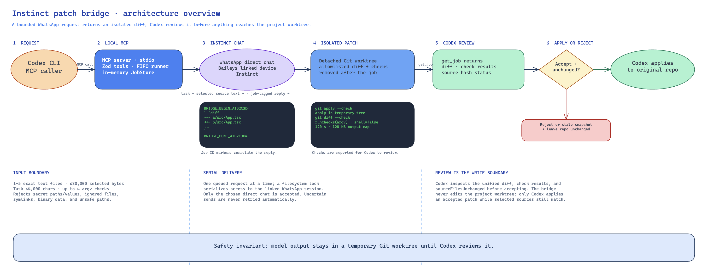

# Local Instinct delegation bridge

Codex can delegate small code edits to Instinct over WhatsApp. This local MCP bridge returns a unified diff for Codex to review before applying.

## Architecture



[Editable Excalidraw source](documentation/architecture-overview.excalidraw)

## Setup

Requirements: macOS, Windows, or Linux; Node.js 22.13+; Git; and Codex CLI.

```sh
npm install
npm run whatsapp-setup
npm run install-local
```

Scan the QR code from WhatsApp's **Settings → Linked devices → Link a device**. Message the intended Instinct chat, then confirm its name and ID by typing `YES`. Restart Codex to load the MCP tools. To remove the MCP, run `codex mcp remove instinct-patch-bridge`.

## MCP tools

| Tool | Purpose |
| --- | --- |
| `delegate_patch(repo, task, paths, checks)` | Queue a small task using selected files and optional checks. |
| `get_job(job_id)` | Read status, diff, check results, and whether source files changed. |
| `list_jobs(limit)` | List recent jobs without diffs. |
| `cancel_job(job_id)` | Cancel local processing. A request already sent may continue in Instinct. |
| `record_review(job_id, accepted, codex_tokens)` | Record the review decision and token count, if known. |

## Safety and local data

- Select 1 to 5 exact text files, up to 30 KB total. The bridge blocks common secret paths and values, ignored files, symlinks, and binary files. This filter is not a guarantee, so only select source that is safe to share.
- The bridge applies patches and runs caller-supplied checks in a temporary Git worktree. Checks use argument arrays with `shell=false`, a 120-second timeout, and a 128 KB output limit.
- The bridge never edits the project working tree. Codex reviews the diff and checks, then applies accepted changes only if `sourceFilesUnchanged` is true.
- Jobs live in MCP process memory and disappear when it stops. Jobs run one at a time, and uncertain WhatsApp requests are not resent automatically.
- `.instinct-bridge/` stores linked-device credentials, the selected chat, and temporary worktrees. Set `INSTINCT_BRIDGE_HOME` to use another absolute path. Auth directories use mode `0700`; auth and target files use `0600` where supported.
- WhatsApp uses Baileys, not the official WhatsApp API. WhatsApp may restrict accounts for unauthorized automation. See [OpenClaw's WhatsApp docs](https://docs.openclaw.ai/providers/whatsapp) and [Baileys' disclaimer](https://github.com/WhiskeySockets/Baileys#disclaimer). History sync is disabled. During jobs, the bridge accepts replies only from the selected direct chat.

## Development

```sh
npm run typecheck
npm test
npm run build
```
